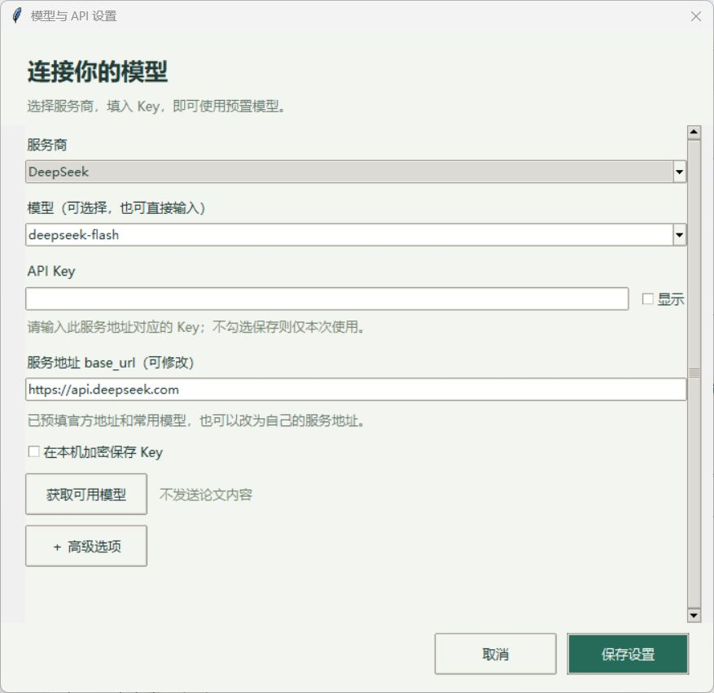
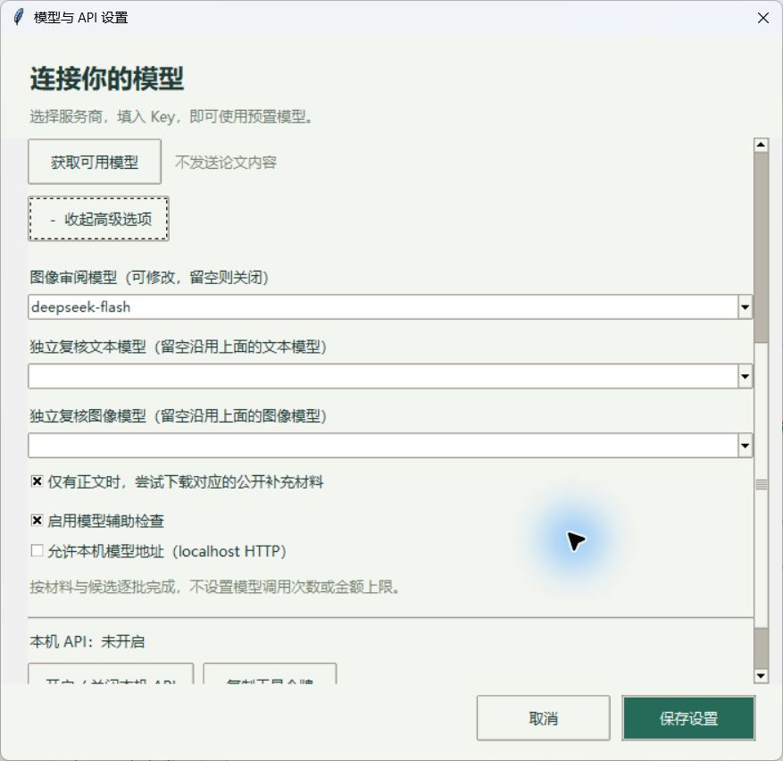
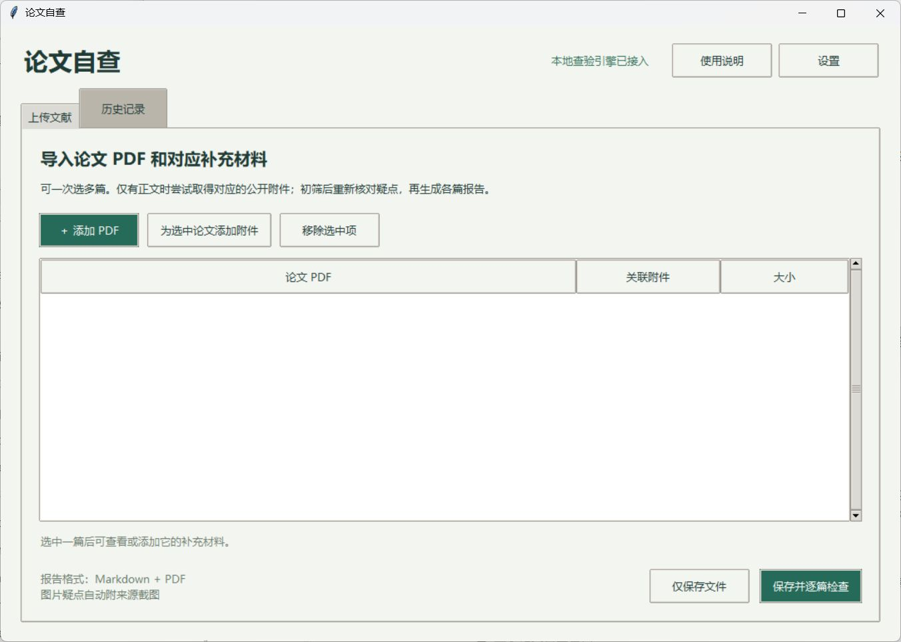
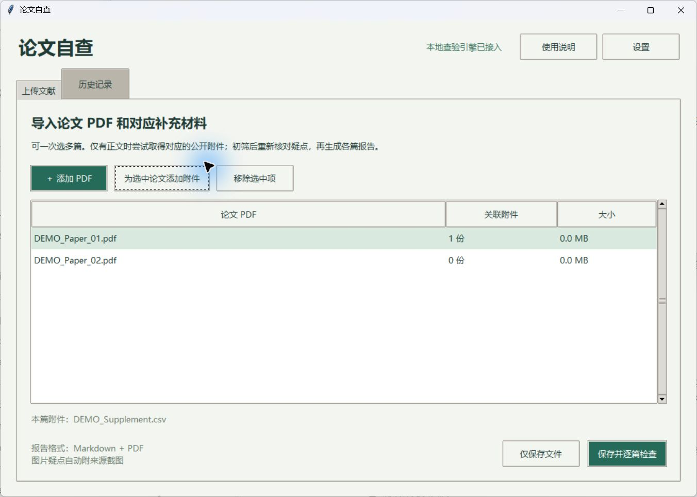
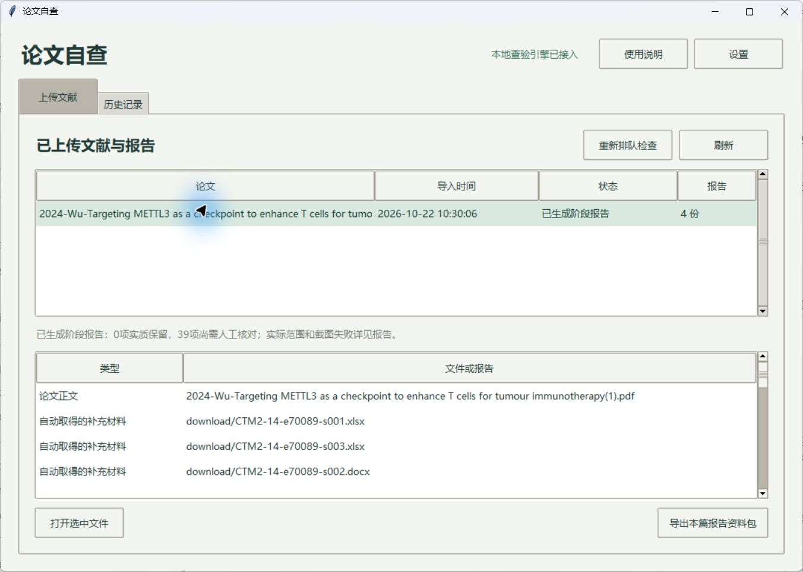
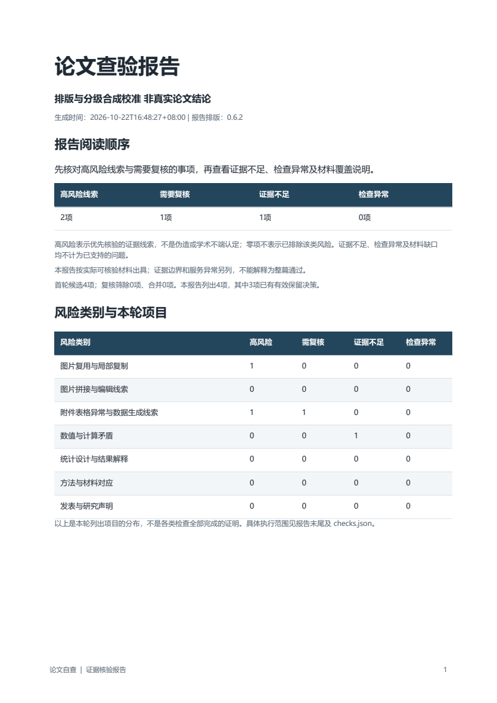
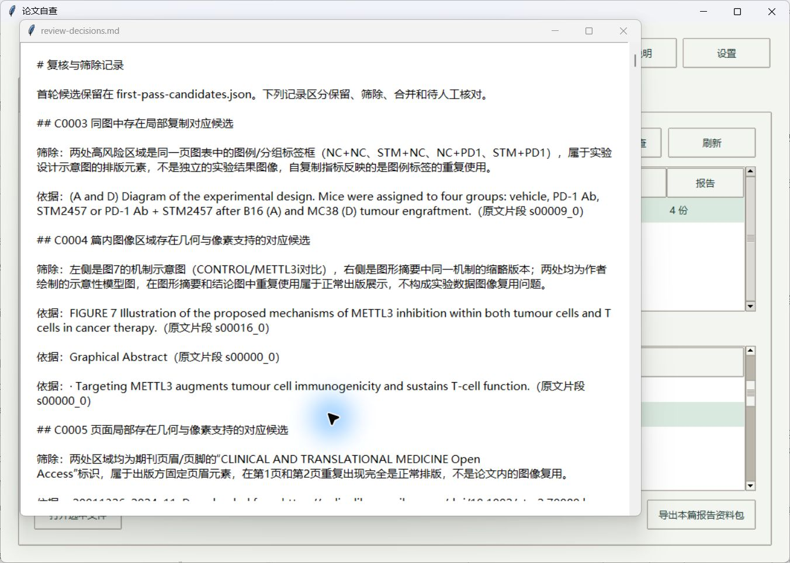

# 论文自查使用说明

Windows版0.6.2。完整解压发行包后，双击PaperAudit.exe。主界面保留“上传文献”和“历史记录”两个面板。

## 配置模型

打开右上角的模型设置，选择DeepSeek、Kimi、豆包、Qwen或自定义服务，填写自己的API Key。模型名称和base_url都可以修改。豆包可填写账号对应的模型接入点；不同服务商的Key不能混用。

Key可只在本次运行中使用，也可通过Windows用户保护机制加密保存。更换服务地址后，需要重新输入Key。模型服务商提供的账户权限、上下文长度和余额仍会影响请求；程序不设置模型金额或调用次数配额。

高级选项中可指定独立复核模型和视觉模型。文本模型不能替代图片输入能力。若需要图片核验，请填写支持图片输入的视觉模型。启用本机API后，其他程序可以使用本次运行生成的工具令牌调用，具体格式见API说明.md。

## 导入论文与附件

在上传面板添加一篇或多篇PDF。选中某一篇，再添加属于它的补充材料；每篇论文的附件单独关联。点击保存并检查后，程序按篇依次处理，不会把多篇正文混在一起分析。

只有正文时，程序会尝试寻找可确认归属的公开补充材料。找到后下载并一同分析；遇到登录、付费或无法确认归属的文件则跳过，在报告中说明实际范围。

## 检查与自动补证

程序依次解析材料、生成候选、独立复核、补齐争议来源，再生成报告。对表格疑点，会补读完整单元格、表头和相邻行；对正文疑点，会核对相关方法和图注。模型输出不符合格式或引文要求时，会请求修正。

过程中可在历史记录中查看进度。关闭程序会中断正在进行的检查；再次运行后应重新排队。若只是报告导出出错，已有分析结果仍保留，可重新生成报告。

## 阅读与导出报告

报告首页分别列出高风险线索、需要复核、证据不足和检查异常。前两类是应核对的论文疑点；后两类说明判断依据和工具执行的边界。检查异常不会计入论文风险。

每项列出观察、分级依据、合理解释、后续建议与来源图。表格图从实际单元格生成，图片图来自原件裁图。截图生成失败会说明原因。高风险0项不能解释成整篇论文没有问题。

在历史记录中选中文献，可打开原件、Markdown、PDF、风险分级清单和筛除记录。导出完整资料包可以保留截图和相对链接，便于换电脑阅读。

## 备份、更新与常见问题

材料库默认保存在当前用户的%LOCALAPPDATA%\PaperAudit。更新前退出程序并备份整个文件夹，随后解压新版程序。不要只复制报告Markdown而漏掉images文件夹。

证据不足表示已审阅但仍缺必要依据，例如作者未公开的原始计数矩阵。检查异常则应查看具体原因：Key或地址错误需要修正配置，网络问题可在恢复后重新检查，图片输入不受支持时需要改用视觉模型。反复出现同一异常时，保留报告和复核记录，便于定位。

本工具用于发现和核对线索。重复小数、异常尾数、相似图片或不同实验使用不同参数，都需要结合具体来源解释；不能单独作为学术不端认定。
